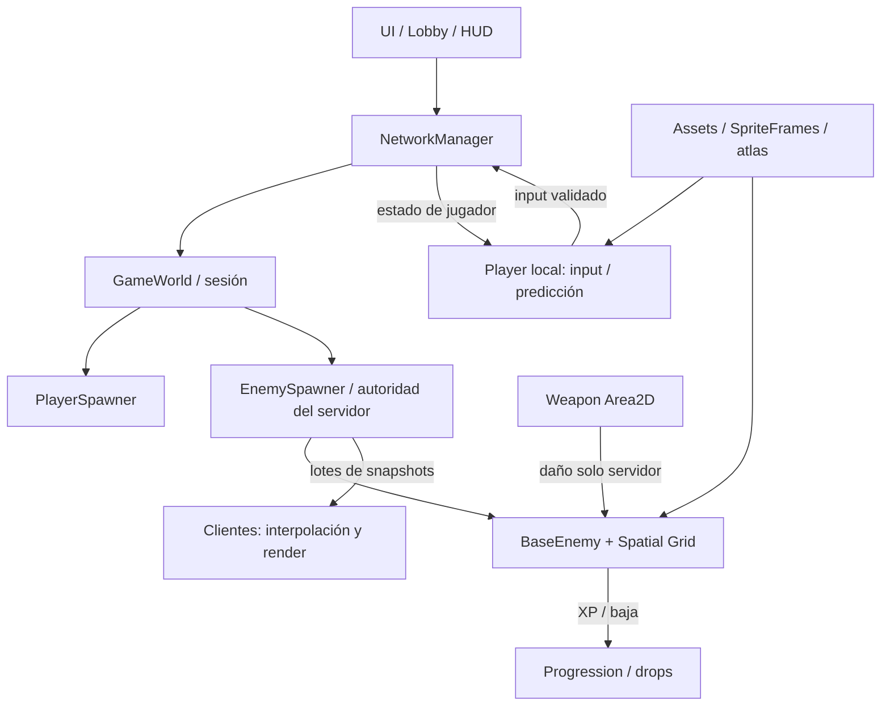

# Hordas cooperativo — Arquitectura técnica y plan de implementación

## Estado del documento

- Versión: 3
- Fecha: 2026-11-25
- Motor objetivo: Godot 4.7.2 stable, GDScript 2.0
- Estado: MVP ejecutable acompañado por el código actual; SQLite local está activa, MySQL tiene esquema para backend y hay tres mapas en el catálogo. La validación cooperativa de mapas y backend remoto siguen pendientes.
- Supuestos de diseño: supervivencia roguelite top-down 2D, opción de presentación 2.5D, 1–4 jugadores, una partida por sesión, conexión directa por IP/puerto y autoridad del host/servidor.
- Decisiones vigentes: consultar [ADR-0001 (ENet autoritativo)](../adr/0001-host-authoritative-enet.md), [ADR-0002 (persistencia)](../adr/0002-sqlite-profile-and-mysql-service.md) y [ADR-0003 (mapas)](../adr/0003-data-driven-cooperative-maps.md).

Este documento conserva el diseño general y el orden de producción; para el estado actual, controles, mapas y persistencia, consultar [contexto](../CONTEXT.md), [estado de implementación](../implementation-status.md) y [índice documental](../INDEX.md). El código fuente ejecutable vive en las rutas descritas en §11 y prevalece sobre ejemplos esquemáticos de GDScript en §4–7. El proyecto no incluye arte, personajes ni código de League of Legends. Los recursos externos deben tener licencia compatible con el uso previsto.

## 1. Decisiones de arquitectura

### 1.1 Topología de red

Usar ENet/UDP con el modelo **cliente-servidor autoritativo**, donde el host jugador ejerce de servidor en una partida P2P hospedada, o se ejecuta el mismo código en una build dedicada sin ventana. El cliente nunca decide salud, experiencia, selección de objetivo, impactos ni generación de oleadas. Solo envía intención de movimiento y acciones permitidas; el servidor valida, simula y publica el estado.

Esto es la arquitectura P2P más práctica para un roguelite cooperativo: todos los peers se conectan al host, pero no hay autoridad distribuida ni malla entre clientes. Una malla ENet `create_mesh()` exigiría conexión manual y resolución de NAT, y permitiría divergencia de combate. ENet necesita UDP accesible; IP/puerto directo no incluye lobby, matchmaking, relay ni traversal de NAT. Para jugar por Internet sin abrir puertos, agregar posteriormente un servicio de relay o una capa de lobby.

El servidor dedicado es una modalidad de despliegue del mismo host autoritativo, no una arquitectura alternativa. Mantener la simulación en funciones de servidor facilita ejecutarla en modo headless.

### 1.2 Presupuesto inicial y límites

Objetivo inicial medible: 4 jugadores, hasta 250 enemigos activos, IA del servidor a 30 ticks/s, estado de enemigos enviado en lotes a 10 Hz, y propiedades de jugador replicadas a 15–20 Hz. Son presupuestos de arranque; deben perfilarse con arte y equipos objetivo. No sincronizar nodo por nodo las hordas a 60 Hz.

Los jugadores usan predicción local sencilla del movimiento y corrección hacia la posición del host. Los enemigos se simulan exclusivamente en el host. En clientes, los snapshots se interpolan visualmente. No se promete latencia cero: en Internet habrá retraso de ida y vuelta y el servidor conserva la verdad para evitar divergencias.

### 1.3 Capas y flujo



| Módulo | Responsabilidad / autoridad | API entre módulos |
|---|---|---|
| `autoload/NetworkManager` | Conexión, errores, cambio de escena, altas/bajas de peers y creación de jugadores. | Señales `connection_changed`, `peer_joined`, `peer_left`; `host_game`, `join_game`, `leave_game`. |
| `features/session/GameWorld` | Raíz de partida, spawners, registro de entidades vivas y estado de sesión. | Registra el `MultiplayerSpawner` de jugadores y provee puntos de spawn. |
| `features/player` | Entrada, movimiento, presentación y atributos del jugador. Cliente dueño lee el input; servidor valida y simula el estado definitivo. | `submit_input`; `grant_xp`; `apply_damage` solo servidor. |
| `features/enemy` | Oleadas, creación/destrucción, IA y lotes de estado de la horda. | `spawn_enemy`, `server_tick`, `take_damage`, snapshot compactado. |
| `features/weapons` | Cadencia, área de ataque, proyectiles y datos de armas. | Impacto llama a `take_damage` localmente en el host. No RPC de daño del cliente. |
| `features/progression` | XP, niveles y ofertas de mejora validadas por servidor. | Señales de XP/nivel; sincroniza valores discretos. |
| `shared/resources` | Definiciones inmutables de armas, enemigos, oleadas y personajes como `.tres`. | Recursos cargados por escena; no se replican recursos Godot por red. |
| `art/external` | Archivos originales descargados, separados de los recursos procesados. | Escenas usan recursos importados de `art/processed`. |

## 2. Arquitectura de carpetas

```text
res://
  project.godot
  autoload/
    NetworkManager.gd
    AudioManager.gd
    RunState.gd
  scenes/
    boot/Boot.tscn
    menus/MainMenu.tscn
    session/GameWorld.tscn
    ui/HUD.tscn
  features/
    session/
      GameWorld.gd
      SpawnPoints.gd
    player/
      Player.tscn
      Player.gd
      PlayerVisual.gd
      components/HealthComponent.gd
      components/ExperienceComponent.gd
    enemy/
      BaseEnemy.tscn
      BaseEnemy.gd
      EnemySpawner.gd
      EnemySpatialGrid.gd
    weapons/
      CircularPulse.tscn
      CircularPulse.gd
      WeaponController.gd
      Projectile.tscn
    progression/
      ProgressionService.gd
      UpgradeChoice.tscn
    ui/
      lobby/Lobby.gd
      hud/HUD.gd
      menus/PauseMenu.gd
  shared/
    resources/
      enemies/Grunt.tres
      weapons/CircularPulse.tres
      waves/DefaultWaveSet.tres
    data/
    utilities/
  art/
    external/                 # originales, fuente/licencia y notas
    processed/
      characters/
      enemies/
      effects/
      environments/
      tilesets/
  audio/
  docs/
    architecture/
  tests/
```

Mantener escenas de arte intercambiables: `Player.tscn` debe apuntar a una escena hija `PlayerVisual.tscn` o a un recurso `SpriteFrames`. La lógica de movimiento no busca nodos de arte por nombres de atlas; solo manda estados semánticos (`idle`, `run`, `attack`, `death`) a una interfaz visual.

## 3. Escenas y configuración del editor

### 3.1 `GameWorld.tscn`

```text
GameWorld (Node2D, script GameWorld.gd)
├── Actors (Node2D, y_sort_enabled)
├── PlayerSpawner (MultiplayerSpawner)
├── EnemySpawner (Node, script EnemySpawner.gd)
│   └── EnemySpawner (MultiplayerSpawner)
├── WorldEnvironment (opcional)
└── HUD (CanvasLayer)
```

Configurar `PlayerSpawner.spawn_path = ../Actors`, `EnemySpawner/MultiplayerSpawner.spawn_path = ../../Actors` y el `MultiplayerSpawner` de enemigos con una escena si se usa `spawn(data)` personalizado. Ambos spawners agregan jugadores/enemigos como hijos directos de `Actors`, que ordena los personajes por eje Y. El patrón de spawn personalizado llama `spawn_function` en todos los peers y esta debe devolver una instancia aún fuera del árbol; el propio spawner la agrega.

### 3.2 `Player.tscn`

```text
Player (CharacterBody2D, script Player.gd; autoridad de red = peer 1)
├── CollisionShape2D
├── Visual (PlayerVisual.gd con AnimatedSprite2D opcional)
├── WeaponMount (Node2D)
│   └── CircularPulse (Area2D)
│       └── CollisionShape2D (CircleShape2D)
└── MultiplayerSynchronizer
```

En `MultiplayerSynchronizer`, `root_path = ..`; `replication_interval = 0.05` a `0.067` segundos. En `SceneReplicationConfig`, replicar desde la autoridad las propiedades `replicated_position`, `replicated_health`, `replicated_xp`, `replicated_level`, `replicated_facing` y `replicated_animation`. Dejar la autoridad del `Player` y del `Synchronizer` en peer 1 para que el cliente no pueda publicar salud ni progreso. La interpolación de presentación la hace `Player.gd`; `MultiplayerSynchronizer` replica propiedades, pero no es por sí mismo un sistema de rollback ni de interpolación.

### 3.3 `BaseEnemy.tscn`

```text
BaseEnemy (CharacterBody2D, script BaseEnemy.gd; autoridad = peer 1)
├── CollisionShape2D
├── Visual (AnimatedSprite2D)
└── Hurtbox (Area2D, opcional si se usa el cuerpo para el impacto)
    └── CollisionShape2D
```

El spawner transmite creación/destrucción con `MultiplayerSpawner`. Las posiciones se mandan en un RPC por lote, no con un `MultiplayerSynchronizer` por enemigo. El lote tiene IDs estables de sesión y posiciones en arrays compactos; cada cliente interpola entre dos snapshots. Conservar por ahora un `CharacterBody2D` por enemigo para colisiones y daño. Para cientos o miles de entidades, migrar la simulación a datos/arreglos y renderizar con `MultiMeshInstance2D`; esa optimización requiere medir antes de sustituir colisiones.

## 4. Red, sesión y sincronización

`ENetMultiplayerPeer` implementa la capa peer de Godot sobre UDP. La documentación oficial describe `MultiplayerSpawner` como replicador de altas/bajas y `MultiplayerSynchronizer` como replicador de propiedades configuradas desde la autoridad. ENet necesita que el puerto UDP sea accesible en el host cuando la conexión es directa. [High-level multiplayer](https://docs.godotengine.org/en/4.7/tutorials/networking/high_level_multiplayer.html), [MultiplayerSpawner](https://docs.godotengine.org/en/4.7/classes/class_multiplayerspawner.html), [MultiplayerSynchronizer](https://docs.godotengine.org/en/4.7/classes/class_multiplayersynchronizer.html), [ENetMultiplayerPeer](https://docs.godotengine.org/en/4.7/classes/class_enetmultiplayerpeer.html).

### 4.1 `autoload/NetworkManager.gd`

Añadir `NetworkManager.gd` a Project Settings → Globals → Autoload con nombre `NetworkManager`. La escena `GameWorld.tscn` se usa al crear/unirse a una sesión. El modo se bloquea al iniciar partida: no admitir entrada tardía en este primer corte; así no se necesita enviar snapshot tardío completo de una horda activa.

```gdscript
extends Node
class_name NetworkManagerClass

signal connection_changed(connected: bool, message: String)
signal peer_joined(peer_id: int)
signal peer_left(peer_id: int)

const PORT_DEFAULT: int = 2456
const MAX_CLIENTS: int = 3 # además del host: 4 jugadores totales
const GAME_SCENE: String = "res://scenes/session/GameWorld.tscn"

var _peer: ENetMultiplayerPeer
var _is_connecting: bool = false

func _ready() -> void:
	multiplayer.peer_connected.connect(_on_peer_connected)
	multiplayer.peer_disconnected.connect(_on_peer_disconnected)
	multiplayer.connected_to_server.connect(_on_connected_to_server)
	multiplayer.connection_failed.connect(_on_connection_failed)
	multiplayer.server_disconnected.connect(_on_server_disconnected)

func host_game(port: int = PORT_DEFAULT) -> Error:
	_close_peer()
	_peer = ENetMultiplayerPeer.new()
	var error: Error = _peer.create_server(port, MAX_CLIENTS)
	if error != OK:
		_peer = null
		connection_changed.emit(false, "No se pudo abrir el puerto UDP %d (error %d)." % [port, error])
		return error
	multiplayer.multiplayer_peer = _peer
	_is_connecting = false
	connection_changed.emit(true, "Servidor iniciado en UDP %d." % port)
	get_tree().change_scene_to_file(GAME_SCENE)
	return OK

func join_game(address: String, port: int = PORT_DEFAULT) -> Error:
	if address.strip_edges().is_empty() or port < 1 or port > 65535:
		return ERR_INVALID_PARAMETER
	_close_peer()
	_peer = ENetMultiplayerPeer.new()
	var error: Error = _peer.create_client(address.strip_edges(), port)
	if error != OK:
		_peer = null
		connection_changed.emit(false, "No se pudo iniciar la conexión (error %d)." % error)
		return error
	multiplayer.multiplayer_peer = _peer
	_is_connecting = true
	connection_changed.emit(false, "Conectando a %s:%d…" % [address, port])
	return OK

func leave_game() -> void:
	_close_peer()
	_is_connecting = false
	get_tree().change_scene_to_file("res://scenes/menus/MainMenu.tscn")
	connection_changed.emit(false, "Sesión cerrada.")

func _close_peer() -> void:
	multiplayer.multiplayer_peer = OfflineMultiplayerPeer.new()
	if _peer != null:
		_peer.close()
		_peer = null

func _on_connected_to_server() -> void:
	_is_connecting = false
	connection_changed.emit(true, "Conectado al host.")
	get_tree().change_scene_to_file(GAME_SCENE)

func _on_connection_failed() -> void:
	_is_connecting = false
	connection_changed.emit(false, "Falló la conexión. Comprueba IP, puerto UDP y firewall.")
	_close_peer()

func _on_server_disconnected() -> void:
	_is_connecting = false
	connection_changed.emit(false, "El host cerró la sesión.")
	_close_peer()
	get_tree().change_scene_to_file("res://scenes/menus/MainMenu.tscn")

func _on_peer_connected(peer_id: int) -> void:
	peer_joined.emit(peer_id)
	if multiplayer.is_server():
		_spawn_player_for_peer(peer_id)

func _on_peer_disconnected(peer_id: int) -> void:
	peer_left.emit(peer_id)
	if multiplayer.is_server():
		_despawn_player_for_peer(peer_id)

func register_world(world: Node) -> void:
	if not multiplayer.is_server():
		return
	_spawn_player_for_peer(1)
	for peer_id: int in multiplayer.get_peers():
		_spawn_player_for_peer(peer_id)

func _spawn_player_for_peer(peer_id: int) -> void:
	var worlds: Array[Node] = get_tree().get_nodes_in_group("session_world")
	if worlds.is_empty():
		return # GameWorld.register_world repetirá el registro al terminar de cargar.
	var world: Node = worlds[0]
	world.call("spawn_player", peer_id)

func _despawn_player_for_peer(peer_id: int) -> void:
	var worlds: Array[Node] = get_tree().get_nodes_in_group("session_world")
	if not worlds.is_empty():
		worlds[0].call("despawn_player", peer_id)
```

El singleton gestiona conexión y altas, pero delega el nodo de spawn al `GameWorld` activo. Las señales `peer_connected` llegan al servidor y el spawner replica el nuevo nodo. Para evitar duplicados, `GameWorld.spawn_player()` consulta su registro antes de llamar a `spawn()`.

### 4.2 `features/session/GameWorld.gd`

```gdscript
extends Node2D
class_name GameWorld

const PLAYER_SCENE: PackedScene = preload("res://features/player/Player.tscn")

@onready var _player_spawner: MultiplayerSpawner = $PlayerSpawner

var _players_by_peer: Dictionary = {}

func _ready() -> void:
	add_to_group("session_world")
	_player_spawner.spawn_path = NodePath("../Actors")
	_player_spawner.spawn_function = _make_player
	NetworkManager.register_world(self)

func spawn_player(peer_id: int) -> void:
	if not multiplayer.is_server() or _players_by_peer.has(peer_id):
		return
	_player_spawner.spawn(peer_id)

func despawn_player(peer_id: int) -> void:
	if not multiplayer.is_server():
		return
	var player: Node = _players_by_peer.get(peer_id)
	if is_instance_valid(player):
		_players_by_peer.erase(peer_id)
		player.queue_free() # los hijos directos de spawn_path se replican como bajas

func _make_player(data: Variant) -> Node:
	var peer_id: int = int(data)
	var player: Player = PLAYER_SCENE.instantiate() as Player
	player.name = "Player_%d" % peer_id
	player.peer_id = peer_id
	player.global_position = Vector2((peer_id - 1) * 48, 0)
	_players_by_peer[peer_id] = player
	return player
```

Al configurar `GameWorld.tscn`, `PlayerSpawner` debe ser hijo de `GameWorld` y `Actors` el nodo de destino. En código se reasigna `spawn_path` para que la ruta sea explícita. Si el jugador host ya existe al iniciar, su identificador es 1. Los clientes reciben la misma escena y ejecutan la misma función de spawn.

### 4.3 Flujo de autoridad y uso de RPC

1. El cliente dueño lee input y predice localmente su desplazamiento.
2. Envía un vector normalizado mediante RPC no fiable al peer 1.
3. El host verifica `get_remote_sender_id() == peer_id`, limita valores y simula el movimiento.
4. `MultiplayerSynchronizer` replica objetivo de posición y propiedades discretas desde peer 1.
5. El dueño corrige su predicción; los demás clientes interpolan el objetivo replicado.
6. Oleadas, impactos, XP y muerte solo los confirma el host. No se permite que un cliente llame a un RPC público de daño.

`@rpc("any_peer")` solo describe quién puede invocar el método. No impone que el remitente sea el dueño del jugador. Siempre validar ID del remitente y rango de datos. `_submit_input` usa `call_local`: la copia del dueño retorna porque no es servidor, y el peer 1 acepta la entrada tras validar remitente. `call_local` no concede propiedad ni autoridad. El host procesa su input directamente para no duplicarlo.

## 5. Controlador de jugador

### 5.1 `features/player/Player.gd`

```gdscript
extends CharacterBody2D
class_name Player

@export var peer_id: int = 1
@export var move_speed: float = 230.0
@export var max_health: float = 100.0
@export var xp_per_level: int = 100
@export var target_search_radius: float = 520.0

var replicated_position: Vector2 = Vector2.ZERO
var replicated_health: float = 100.0
var replicated_xp: int = 0
var replicated_level: int = 1
var replicated_facing: Vector2 = Vector2.RIGHT
var replicated_animation: StringName = &"idle"

var _server_input: Vector2 = Vector2.ZERO
var _attack_target: Node2D
var _dead: bool = false
var _attack_animation_left: float = 0.0

@onready var _visual: AnimatedSprite2D = $Visual

func _ready() -> void:
	add_to_group("players")
	replicated_health = max_health
	replicated_position = global_position

func _physics_process(delta: float) -> void:
	if replicated_health <= 0.0 and not _dead:
		_dead = true
		replicated_animation = &"death"
		_update_animation_from_state()
	if _dead:
		return
	var is_server: bool = multiplayer.is_server()
	var is_owner: bool = multiplayer.get_unique_id() == peer_id
	if is_server:
		_attack_animation_left = maxf(0.0, _attack_animation_left - delta)
		if peer_id == 1:
			_server_input = _read_move_input()
		_server_move(_server_input, delta)
		replicated_position = global_position
		replicated_facing = _facing_from_velocity()
		_update_auto_target()
		_update_animation_from_velocity()
	elif is_owner:
		var input_vector: Vector2 = _read_move_input()
		_submit_input.rpc_id(1, input_vector)
		_server_move(input_vector, delta) # predicción local
		var correction: Vector2 = replicated_position - global_position
		if correction.length_squared() > 64.0:
			global_position += correction * (1.0 - exp(-delta * 8.0))
		replicated_facing = _facing_from_velocity()
		_update_animation_from_velocity()
	else:
		# Suavizado exponencial del objetivo del MultiplayerSynchronizer.
		global_position = global_position.lerp(replicated_position, 1.0 - exp(-delta * 14.0))
		_update_animation_from_state()

func _read_move_input() -> Vector2:
	var direction: Vector2 = Input.get_vector("move_left", "move_right", "move_up", "move_down")
	return direction.limit_length(1.0)

func _server_move(direction: Vector2, _delta: float) -> void:
	velocity = direction.limit_length(1.0) * move_speed
	move_and_slide()

@rpc("any_peer", "call_local", "unreliable_ordered")
func _submit_input(direction: Vector2) -> void:
	if not multiplayer.is_server() or _dead:
		return
	var sender_id: int = multiplayer.get_remote_sender_id()
	if sender_id != peer_id or not is_finite(direction.x) or not is_finite(direction.y):
		return
	_server_input = direction.limit_length(1.0)

func _facing_from_velocity() -> Vector2:
	if velocity.length_squared() > 1.0:
		return velocity.normalized()
	return replicated_facing

func _update_auto_target() -> void:
	if not multiplayer.is_server():
		return
	var best_distance_squared: float = target_search_radius * target_search_radius
	var best_target: Node2D = null
	for node: Node in get_tree().get_nodes_in_group("enemies"):
		var enemy: Node2D = node as Node2D
		if enemy == null or not enemy.get("alive"):
			continue
		var distance_squared: float = global_position.distance_squared_to(enemy.global_position)
		if distance_squared < best_distance_squared:
			best_distance_squared = distance_squared
			best_target = enemy
	_attack_target = best_target
	if is_instance_valid(best_target):
		replicated_facing = (best_target.global_position - global_position).normalized()

func get_auto_target() -> Node2D:
	return _attack_target if is_instance_valid(_attack_target) else null

func trigger_attack_visual() -> void:
	if not multiplayer.is_server() or _dead:
		return
	_attack_animation_left = 0.18
	replicated_animation = &"attack"

func grant_xp(amount: int) -> void:
	if not multiplayer.is_server() or amount <= 0 or _dead:
		return
	replicated_xp += amount
	while replicated_xp >= xp_per_level:
		replicated_xp -= xp_per_level
		replicated_level += 1
		level_up.emit(replicated_level)

signal level_up(level: int)

func apply_damage(amount: float) -> void:
	if not multiplayer.is_server() or amount <= 0.0 or _dead:
		return
	replicated_health = maxf(0.0, replicated_health - amount)
	if replicated_health <= 0.0:
		_dead = true
		replicated_animation = &"death"
		_update_animation_from_state()
		death_requested.emit(peer_id)

signal death_requested(peer_id: int)

func _update_animation_from_velocity() -> void:
	if _dead:
		replicated_animation = &"death"
	elif _attack_animation_left > 0.0:
		replicated_animation = &"attack"
	elif velocity.length_squared() > 4.0:
		replicated_animation = &"run"
	else:
		replicated_animation = &"idle"
	_update_animation_from_state()

func _update_animation_from_state() -> void:
	if _visual == null or _visual.sprite_frames == null:
		return
	if absf(replicated_facing.x) > 0.01:
		_visual.flip_h = replicated_facing.x < 0.0
	if _visual.sprite_frames.has_animation(replicated_animation):
		if _visual.animation != replicated_animation:
			_visual.play(replicated_animation)
		elif not _visual.is_playing():
			_visual.play()
```

Configurar acciones en `Project Settings → Input Map`: `move_left` (A/←), `move_right` (D/→), `move_up` (W/↑), `move_down` (S/↓). El procesamiento queda habilitado en todos los peers para simular input autorizado o interpolar. El host ejecuta `_server_move` en todos los jugadores; solo la instancia dueña lee controles en un cliente. El campo `_attack_target` solo se decide en host. Para esquivar teletransporte/cheat, producción debe añadir secuencia de input, límite de velocidad y límites de arena.

La implementación añade secuencias crecientes, confirmación autoritativa y replay de inputs pendientes al reconciliar. El buffer está acotado a 120 muestras; la entrada sigue siendo una muestra de movimiento, no una simulación de colisión local, y debe verificarse en red con latencia antes de considerarse producción.

## 6. Enemigos, oleadas y simulación masiva

### 6.1 `features/enemy/BaseEnemy.gd`

```gdscript
extends CharacterBody2D
class_name BaseEnemy

@export var max_health: float = 24.0
@export var move_speed: float = 74.0
@export var separation_radius: float = 30.0
@export var xp_reward: int = 6

var net_id: int = -1
var health: float = 24.0
var alive: bool = true
var replicated_position: Vector2 = Vector2.ZERO

signal died(net_id: int)

func _ready() -> void:
	add_to_group("enemies")
	health = max_health
	replicated_position = global_position
	set_physics_process(false) # EnemySpawner llama server_tick solo en autoridad.

func server_tick(delta: float, target: Node2D, neighbors: Array) -> void:
	if not multiplayer.is_server() or not alive or not is_instance_valid(target):
		return
	var toward_target: Vector2 = target.global_position - global_position
	var direction: Vector2 = toward_target.normalized()
	var separation: Vector2 = Vector2.ZERO
	var radius_squared: float = separation_radius * separation_radius
	for candidate_variant: Variant in neighbors:
		var other: BaseEnemy = candidate_variant as BaseEnemy
		if other == null or other == self or not other.alive:
			continue
		var offset: Vector2 = global_position - other.global_position
		var distance_squared: float = offset.length_squared()
		if distance_squared > 0.001 and distance_squared < radius_squared:
			separation += offset.normalized() * (1.0 - sqrt(distance_squared) / separation_radius)
	if separation.length_squared() > 0.0:
		direction = (direction + separation.normalized() * 0.85).normalized()
	velocity = direction * move_speed
	move_and_slide()
	replicated_position = global_position

func take_damage(amount: float, source_peer: int = 1) -> void:
	if not multiplayer.is_server() or not alive or amount <= 0.0:
		return
	# source_peer se conserva para métricas/recompensas; no se confía en datos del cliente.
	health = maxf(0.0, health - amount)
	if health == 0.0:
		alive = false
		var players: Array[Node] = get_tree().get_nodes_in_group("players")
		var credited_player: Player
		for node: Node in players:
			var player: Player = node as Player
			if player != null and player.peer_id == source_peer:
				credited_player = player
				break
		if credited_player == null and not players.is_empty():
			credited_player = _nearest_player(players)
		if credited_player != null:
			credited_player.grant_xp(xp_reward)
		died.emit(net_id)
		queue_free() # MultiplayerSpawner replica la baja al resto.

func _nearest_player(players: Array[Node]) -> Player:
	var nearest: Player
	var nearest_distance: float = INF
	for node: Node in players:
		var player: Player = node as Player
		if player == null or player.replicated_health <= 0.0:
			continue
		var distance: float = global_position.distance_squared_to(player.global_position)
		if distance < nearest_distance:
			nearest_distance = distance
			nearest = player
	return nearest
```

### 6.2 `features/enemy/EnemySpawner.gd`

Esta versión usa spawn/despawn replicados por `MultiplayerSpawner` y una sola RPC de posiciones por tick de snapshot. El `Spatial Grid` evita comparar cada enemigo con todos los demás para separación: cada entidad consulta únicamente su celda y las ocho vecinas. El escaneo de jugadores es pequeño (máximo cuatro); para más jugadores, cachear la lista y actualizarla por señal.

```gdscript
extends Node
class_name EnemySpawner

const ENEMY_SCENE: PackedScene = preload("res://features/enemy/BaseEnemy.tscn")
const MAX_ALIVE: int = 250
const CELL_SIZE: float = 48.0
const BOSS_AT_SECONDS: float = 300.0

@export var initial_enemies_per_minute: float = 20.0
@export var growth_per_minute: float = 4.0
@export var snapshot_interval: float = 0.1
@export var spawn_radius: float = 650.0

@onready var _multiplayer_spawner: MultiplayerSpawner = $MultiplayerSpawner

var _elapsed: float = 0.0
var _spawn_credit: float = 0.0
var _snapshot_credit: float = 0.0
var _boss_spawned: bool = false
var _next_net_id: int = 1
var _enemies: Dictionary = {} # net_id -> BaseEnemy
var _cells: Dictionary = {} # Vector2i -> Array[BaseEnemy]
var _players: Array[Player] = []

func _ready() -> void:
	_multiplayer_spawner.spawn_path = NodePath("../../Actors")
	_multiplayer_spawner.spawn_function = _make_enemy
	_multiplayer_spawner.despawned.connect(_on_enemy_despawned)
	set_process(not multiplayer.is_server())

func _process(delta: float) -> void:
	if multiplayer.is_server():
		return
	var blend: float = 1.0 - exp(-delta * 12.0)
	for enemy_variant: Variant in _enemies.values():
		var enemy: BaseEnemy = enemy_variant as BaseEnemy
		if is_instance_valid(enemy):
			enemy.global_position = enemy.global_position.lerp(enemy.replicated_position, blend)

func _physics_process(delta: float) -> void:
	if not multiplayer.is_server():
		return
	_elapsed += delta
	_spawn_waves(delta)
	_players = _get_live_players()
	_rebuild_spatial_grid()
	var enemies: Array = _enemies.values()
	for enemy_variant: Variant in enemies:
		var enemy: BaseEnemy = enemy_variant as BaseEnemy
		if not is_instance_valid(enemy) or not enemy.alive:
			continue
		var target: Player = _nearest_player(enemy.global_position)
		if target != null:
			enemy.server_tick(delta, target, _nearby_enemies(enemy.global_position))
	_snapshot_credit += delta
	if _snapshot_credit >= snapshot_interval:
		_snapshot_credit = fmod(_snapshot_credit, snapshot_interval)
		_send_snapshot()

func _spawn_waves(delta: float) -> void:
	var minute: int = int(floor(_elapsed / 60.0))
	var rate: float = initial_enemies_per_minute + float(minute) * growth_per_minute
	_spawn_credit += rate / 60.0 * delta
	while _spawn_credit >= 1.0:
		_spawn_credit -= 1.0
		if _enemies.size() < MAX_ALIVE:
			_spawn_enemy(false)
	if not _boss_spawned and _elapsed >= BOSS_AT_SECONDS and _enemies.size() < MAX_ALIVE:
		_boss_spawned = true
		_spawn_enemy(true)

func _spawn_enemy(is_boss: bool) -> void:
	var id: int = _next_net_id
	_next_net_id += 1
	var center: Vector2 = _party_center()
	var angle: float = randf_range(0.0, TAU)
	var position: Vector2 = center + Vector2.RIGHT.rotated(angle) * spawn_radius
	_multiplayer_spawner.spawn({"id": id, "position": position, "boss": is_boss})

func _make_enemy(data: Variant) -> Node:
	var payload: Dictionary = data
	var enemy: BaseEnemy = ENEMY_SCENE.instantiate() as BaseEnemy
	enemy.net_id = int(payload["id"])
	enemy.global_position = payload["position"]
	if bool(payload["boss"]):
		enemy.max_health = 900.0
		enemy.move_speed = 48.0
		enemy.xp_reward = 250
		# BaseEnemy inicializa salud en _ready, después de aplicar este valor.
	_enemies[enemy.net_id] = enemy
	enemy.died.connect(_on_enemy_died)
	return enemy

func _on_enemy_died(net_id: int) -> void:
	_enemies.erase(net_id)

func _on_enemy_despawned(node: Node) -> void:
	var enemy: BaseEnemy = node as BaseEnemy
	if enemy != null:
		_enemies.erase(enemy.net_id)

func _get_live_players() -> Array[Player]:
	var result: Array[Player] = []
	for node: Node in get_tree().get_nodes_in_group("players"):
		var player: Player = node as Player
		if player != null and player.replicated_health > 0.0:
			result.append(player)
	return result

func _party_center() -> Vector2:
	if _players.is_empty():
		_players = _get_live_players()
	if _players.is_empty():
		return Vector2.ZERO
	var center: Vector2 = Vector2.ZERO
	for player: Player in _players:
		center += player.global_position
	return center / float(_players.size())

func _nearest_player(position: Vector2) -> Player:
	var nearest: Player
	var best_distance: float = INF
	for player: Player in _players:
		var distance: float = position.distance_squared_to(player.global_position)
		if distance < best_distance:
			best_distance = distance
			nearest = player
	return nearest

func _cell_for(position: Vector2) -> Vector2i:
	return Vector2i(floori(position.x / CELL_SIZE), floori(position.y / CELL_SIZE))

func _rebuild_spatial_grid() -> void:
	_cells.clear()
	for enemy_variant: Variant in _enemies.values():
		var enemy: BaseEnemy = enemy_variant as BaseEnemy
		if not is_instance_valid(enemy) or not enemy.alive:
			continue
		var cell: Vector2i = _cell_for(enemy.global_position)
		if not _cells.has(cell):
			_cells[cell] = []
		var bucket: Array = _cells[cell]
		bucket.append(enemy)

func _nearby_enemies(position: Vector2) -> Array:
	var found: Array = []
	var center: Vector2i = _cell_for(position)
	for x: int in range(center.x - 1, center.x + 2):
		for y: int in range(center.y - 1, center.y + 2):
			var bucket: Array = _cells.get(Vector2i(x, y), [])
			found.append_array(bucket)
	return found

func _send_snapshot() -> void:
	var ids: PackedInt32Array = PackedInt32Array()
	var positions: PackedVector2Array = PackedVector2Array()
	for enemy_variant: Variant in _enemies.values():
		var enemy: BaseEnemy = enemy_variant as BaseEnemy
		if is_instance_valid(enemy) and enemy.alive:
			ids.append(enemy.net_id)
			positions.append(enemy.global_position)
	var offset: int = 0
	while offset < ids.size():
		var batch_ids: PackedInt32Array = PackedInt32Array()
		var batch_positions: PackedVector2Array = PackedVector2Array()
		var end: int = mini(offset + 48, ids.size())
		for index: int in range(offset, end):
			batch_ids.append(ids[index])
			batch_positions.append(positions[index])
		_receive_enemy_snapshot.rpc(batch_ids, batch_positions)
		offset = end

@rpc("authority", "call_remote", "unreliable_ordered")
func _receive_enemy_snapshot(ids: PackedInt32Array, positions: PackedVector2Array) -> void:
	if multiplayer.is_server() or ids.size() != positions.size():
		return
	for index: int in range(ids.size()):
		var enemy: BaseEnemy = _enemies.get(ids[index]) as BaseEnemy
		if is_instance_valid(enemy):
			enemy.replicated_position = positions[index]
```

**Nota de implementación importante:** Para que el código anterior procese correctamente enemigos creados en peers remotos, el callback de spawn se ejecuta en cada peer y registra el mismo `net_id`. Ajustar orden de nodos/rutas al montar `GameWorld.tscn`. Si la sincronización de alta del spawner no proporciona snapshot histórico en la versión concreta del proyecto, deshabilitar el join-in-progress (como define el alcance) y crear todos los nodos antes de declarar listo el lobby. Al morir enemigos, `queue_free()` replica el despawn mediante el spawner. Los clientes no ejecutan IA, ataques ni oleadas.

El lote se divide en paquetes de hasta 48 enemigos (aprox. 576 bytes de datos de posición/ID antes del overhead), para evitar datagramas enormes que se fragmenten o pierdan completos. Para una versión más optimizada, cuantizar la posición a enteros (p. ej. décimas de píxel), enviar solo entidades dentro del radio de cámara de cada peer y separar canales: input y snapshots no fiables; inventario, nivel, spawn y eventos de partida fiables. No enviar cada transform de cada enemigo en RPC independiente.

### 6.3 Oleadas y anti-amontonamiento

- La fórmula de ejemplo genera 20 enemigos/minuto y suma 4 por cada minuto transcurrido. A los 300 s crea un jefe una vez. Extraer tiempos, tipos, vida y tasa a un `WaveSet.tres` cuando el diseño se estabilice.
- `MAX_ALIVE` controla el techo de coste. El crédito de spawn se limita mediante población viva; si hay saturación no se acumulan enemigos para una explosión posterior.
- El grid uniforme reduce separación de O(N²) a O(N·k), siendo `k` la población local de nueve celdas. Ajustar `CELL_SIZE` según radio de separación y densidad.
- La separación es una fuerza suave ponderada por distancia, no una colisión rígida entre todos los enemigos. Mantener collision layers separadas; dejar que jugadores/enemigos colisionen solo si el diseño lo requiere.
- Buscar el jugador más cercano es O(4N) con 4 jugadores; para cientos de enemigos es barato. Recalcular objetivo cada 0.1–0.25 s puede reducir trabajo si la escena crece.

## 7. Habilidades, armas y daño

Un arma es un `Resource` de parámetros más un nodo de ejecución. Los datos (`cooldown`, `damage`, `radius`, `pierce`, `projectile_scene`) se guardan en `.tres`; la escena de arma realiza detección y efectos. El servidor crea armas/áreas de combate y decide cada impacto. Los clientes reproducen VFX/UI a partir del estado resultante. Este flujo hace que el resultado sea idéntico sin permitir que varios clientes apliquen el mismo daño.

### 7.1 `features/weapons/CircularPulse.gd`

Escena: `Area2D` con `CollisionShape2D` circular; `monitoring = true`, `monitorable = false`, collision mask que incluya la capa de hurtboxes enemigas. El script escanea superposiciones cada cooldown. Es un ejemplo de pulso circular automático; el mismo límite de autoridad se aplica a espadazos, proyectiles rebotantes y áreas temporales.

```gdscript
extends Area2D
class_name CircularPulse

@export var damage: float = 12.0
@export var cooldown: float = 1.25
@export var radius: float = 110.0

var _cooldown_left: float = 0.0
@onready var _shape: CollisionShape2D = $CollisionShape2D

func _ready() -> void:
	monitoring = true
	monitorable = false
	var circle: CircleShape2D = _shape.shape as CircleShape2D
	if circle != null:
		circle.radius = radius
	set_physics_process(multiplayer.is_server())

func _physics_process(delta: float) -> void:
	if not multiplayer.is_server():
		return
	_cooldown_left = maxf(0.0, _cooldown_left - delta)
	if _cooldown_left > 0.0:
		return
	_cooldown_left = cooldown
	var hit_ids: Dictionary = {}
	for body: Node2D in get_overlapping_bodies():
		var enemy: BaseEnemy = body as BaseEnemy
		if enemy == null or not enemy.alive or hit_ids.has(enemy.net_id):
			continue
		hit_ids[enemy.net_id] = true
		var player: Player = get_parent().get_parent() as Player
		enemy.take_damage(damage, player.peer_id if player != null else 1)
	# Los efectos visuales pueden escucharse localmente en el jugador propietario.
	var owner_player: Player = get_parent().get_parent() as Player
	if owner_player != null:
		owner_player.trigger_attack_visual()
	pulse_triggered.emit(global_position)

signal pulse_triggered(world_position: Vector2)
```

El daño se aplica una vez en host mediante una llamada local tipada, **no** por RPC de daño. La salud, baja y experiencia se replican desde la autoridad y producen el mismo resultado en clientes. Para armas activadas por botón, se envía `request_fire(weapon_id, sequence)` al host; este valida cooldown/munición y crea el impacto. Nunca aceptar desde cliente `enemy_id + damage` como orden válida.

## 8. Recursos visuales y animación

1. Mantén cada descarga original en `art/external/<fuente>/<asset>/` y anota URL de origen, autor, licencia, atribución requerida, fecha y límites de redistribución. No versionar archivos con licencia incompatible.
2. Copia una versión procesada en `art/processed/`. Conserva una única escala de píxel por familia visual y fija pivote/origen de todas las animaciones en el mismo punto, normalmente pies/centro de colisión.
3. En Godot selecciona PNG/WEBP, revisa `Import`: 2D como `Texture2D`, compresión lossless para pixel art y transparencias limpias. Recarga si la imagen fuente cambia. El filter/repeat 2D se define en `CanvasItem` o por el ajuste de proyecto, no en el importador.
4. **Pixel art:** desactivar filtrado lineal en el nodo/material o seleccionar filtro nearest (`CanvasItem > Texture > Filter`), escalar en múltiplos enteros cuando sea viable, evitar mipmaps y compresión con pérdida. Configurar una resolución base y `Stretch Mode` coherente para evitar subpíxeles/temblor.
5. **Arte HD pintado:** usar filtro lineal, `Lossless` o compresión VRAM según memoria/calidad, mipmaps solo si hay reducción frecuente/zoom y comprobar halos del canal alfa. Para zoom-out, validar nitidez y presupuesto de memoria en el target real.
6. Una hoja uniforme puede dividirse en `AnimatedSprite2D > SpriteFrames > Add frames from a Sprite Sheet`, definiendo filas/columnas y rango por animación. Para hojas irregulares, separar regiones con `AtlasTexture`/atlas, usar frames individuales o `AnimationPlayer` animando `Sprite2D.frame`/región. Evitar asumir que todo sprite sheet tiene celdas idénticas.
7. Define las animaciones semánticas con nombres constantes (`idle`, `run`, `attack`, `death`) y velocidades por personaje. El controlador pide el nombre; la escena visual resuelve frames, flip horizontal, offsets y VFX.
8. Replica estado semántico, dirección y eventos de animación importantes; no transmitas frame por frame si la duración y el estado permiten que el cliente reproduzca localmente. Sincronizar `death` y ataques que tengan hit timing autoritativo.
9. Verifica `filter`, colisión, origen, pivote, escala y z-index en la escena final. En 2.5D top-down usar `YSort`/`y_sort_enabled` para profundidad visual, dejando física en XY 2D; no mezclar profundidad falsa con coordenadas de red.

La guía oficial de Godot 4.7 documenta hojas como `SpriteFrames`, y también animación con `AnimationPlayer` y `Sprite2D`; la guía de importación describe opciones de textura y filtros CanvasItem. [2D sprite animation](https://docs.godotengine.org/en/4.7/tutorials/2d/2d_sprite_animation.html), [Importing images](https://docs.godotengine.org/en/4.7/tutorials/assets_pipeline/importing_images.html).

## 9. Plan de implementación paso a paso

Cada paso termina con un artefacto que se puede abrir o inspeccionar. El MVP implementa el flujo principal, la reconciliación de movimiento, la oleada configurable, el objetivo de jefe y el arte base. Aún falta ejecutar validación multijugador/headless y perfilado; el relay y matchmaking requieren infraestructura externa.

### Fase 0 — Base del proyecto

1. Crear proyecto Godot 4.7.2 en la raíz y definir renderer (Compatibility para alcance amplio, Forward+ si se necesitan funciones modernas y hardware lo permite).
2. Fijar resolución lógica, escalado, Input Map, capas/máscaras de colisión y convención de nombres.
3. Crear estructura de carpetas, `Boot.tscn`, `MainMenu.tscn`, `GameWorld.tscn`; agregar `NetworkManager` como autoload.
4. Decidir en ADR: topología autoritativa, límite 4 jugadores, versión mínima/plataformas, puertos/proceso headless y política de ingreso tardío.

### Fase 1 — Vertical slice local

1. Crear `Player.tscn` con `CharacterBody2D`, colisión, `AnimatedSprite2D` temporal y cámara/HUD.
2. Configurar cuatro acciones de movimiento y validar límites de arena.
3. Crear `BaseEnemy.tscn`, pursuit simple, daño y baja.
4. Añadir `CircularPulse.tscn`, detección y feedback de daño; validar que la frecuencia de ataque no depende de FPS.
5. Implementar XP, barra simple y nivel; separar datos y escenas para reemplazar sprites sin tocar reglas.

### Fase 2 — Sesión de red mínima

1. Implementar `host_game`, `join_game`, `leave_game` y mensajes de estado de conexión.
2. Añadir `PlayerSpawner`, spawn/despawn de host/clientes, ID estable y validación de identidad.
3. Probar con dos instancias locales: que host y cliente vean todos los jugadores, y que desconectar un cliente elimine solo su jugador.
4. Añadir input remoto validado y movimiento autoritativo, predicción local, secuencias de input y reconciliación con replay de muestras pendientes.
5. Configurar `MultiplayerSynchronizer` solo para propiedades de jugador y ajustar su intervalo.
6. Añadir timeout/error de conexión y evitar que cada instancia abra una sesión nueva al reconectar.

### Fase 3 — Horda servidor-autoritativa

1. Cambiar el spawner para que oleadas y enemigos existan solo en la autoridad de red.
2. Parametrizar curva de dificultad y boss en `WaveSet.tres`; registrar tiempo de partida en host. `features/enemy/wave_set.tres` contiene los valores del MVP.
3. Construir `EnemySpatialGrid` y separar trabajo de movimiento de la presentación.
4. Replicar alta/baja con `MultiplayerSpawner` y posiciones con arrays empaquetados a 10 Hz.
5. Mantener buffer de dos snapshots recibidos y renderizar con 120 ms de retraso, con extrapolación máxima de 120 ms; falta medir el comportamiento bajo jitter real.
6. Medir bytes/s y CPU con 250 entidades; ajustar `MAX_ALIVE`, frecuencia y radio de visibilidad.

### Fase 4 — Combate y progresión online

1. Centralizar todos los `take_damage` en la autoridad y asignar origen de impacto en host.
2. Armas automáticas: host valida cadencia y target; cliente reproduce animación/VFX replicados como eventos cosméticos.
3. Drops, XP y level-up son objetos/eventos autorizados por host; opciones de mejora se aplican en host tras selección validada.
4. La condición de derrota por wipe y victoria al derrotar al jefe se sincroniza como estado fiable. Revive y espectador quedan fuera del primer MVP.
5. Añadir semilla aleatoria de partida si se busca reproducibilidad; compartir semilla solo para decisiones deterministas, nunca confiar en que cliente simule autoridad.

### Fase 5 — Arte y contenido

1. Registrar licencia y procedencia de Pixel Crawler en `art/ASSET_CREDITS.md` y conservar los términos originales.
2. Procesar una baldosa 16×16, fijar filtrado nearest y normalizar nombres de las hojas que consume el juego.
3. Construir `SpriteFrames` desde las hojas del jugador, esqueletos y jefe orco sin atar la lógica de juego al arte.
4. Añadir idle/run/attack/death y selección direccional; falta comprobar visualmente su reproducción en varias instancias.
5. Implementar pooling de proyectiles/VFX; evaluar pooling de enemigos solo después de resolver spawn/despawn en red.

### Fase 6 — Robustez, despliegue y escalado

1. Ejecutar host + 3 clientes en procesos separados y simular latencia, jitter, pérdida y desconexión.
2. Probar entrada inválida, spam de RPC, velocidades imposibles, IDs duplicados y solicitudes de impacto falsas.
3. Ejecutar build dedicada headless y comprobar que no depende de nodos/UI visuales.
4. Implementar lobby/relay y NAT traversal si se requiere Internet sin configuración manual.
5. Medir en hardware mínimo: frametime cliente, coste de IA host, picos al spawn/despawn y ancho de banda.
6. Solo si el profiling lo justifica: AI a tick reducido, cuantización, interest management por cámara, MultiMesh, ECS/GDExtension o servidor dedicado externo.

## 10. Riesgos, pendientes y criterios de aceptación

### Decisiones pendientes antes de producción

- Plataforma de despliegue, número final de jugadores y presupuesto real de enemigos.
- Lobby, invitaciones, descubrimiento, relay/NAT, reconexión y persistencia de partidas.
- La pausa implementada es local y no congela la sala; el host valida el estado del avatar pausado y las opciones de mejora. Aún requiere prueba multijugador en red degradada.
- Perfil del arte (pixel art o HD), resolución objetivo y licencias de los recursos.
- Necesidad de protección anti-cheat más fuerte que validación de servidor hosteado por jugador.

### Criterios de aceptación de la primera versión online

- Host y hasta 3 clientes pueden entrar por IP/puerto, moverse, atacar y recibir XP.
- El cliente no puede cambiar vida/XP ni matar enemigos mediante llamadas directas.
- La autoridad del host produce el mismo orden de oleadas y resultado de combate para todos.
- Clientes muestran jugadores y enemigos sin saltos severos en una sesión de prueba con latencia simulada; las posiciones remotas son interpoladas.
- El servidor procesa la población objetivo sin rebasar presupuesto acordado de CPU/red; el número debe medirse, no asumirse.
- Sprites y animaciones se cambian reemplazando recursos/escenas visuales, sin reescribir networking o gameplay.

La documentación de Godot es la referencia para validar detalles de API al implementar. Las reglas sobre topología, autoridad, frecuencia y límites anteriores son decisiones de arquitectura propuestas para este juego, y se deben validar con un prototipo multijugador y profiling real.

## 11. Implementación integrada en el proyecto

El MVP está organizado por features y usa componentes de salud/progresión, presentación intercambiable y arma como `Area2D`:

```text
res://
  project.godot
  README.md
  autoload/network_manager.gd
  scenes/boot/boot.tscn
  scenes/menus/main_menu.tscn
  scenes/session/game_world.tscn
  scenes/session/dedicated_server.tscn
  features/
    session/boot.gd
    session/game_world.gd
    player/player.tscn
    player/player.gd
    player/player_visual.gd
    player/components/health_component.gd
    player/components/experience_component.gd
    enemy/base_enemy.tscn
    enemy/base_enemy.gd
    enemy/enemy_visual.gd
    enemy/enemy_spawner.gd
    enemy/wave_set.gd
    enemy/wave_set.tres
    weapons/circular_pulse.tscn
    weapons/circular_pulse.gd
    ui/main_menu.gd
    ui/hud.gd
  art/external/
  art/processed/
```

### Arranque y controles

1. Abrir `D:\projects\hordas-project\project.godot` con el ejecutable Godot 4.7.2 indicado por el usuario y ejecutar el proyecto.
2. En el menú, el host crea una sala; los demás introducen dirección y puerto UDP (por defecto `2456`) y se unen.
3. El host pulsa **Iniciar partida** después de que aparezca el grupo. La escena solo crea personajes cuando cada peer confirmó que su mundo está cargado.
4. WASD/flechas o el stick izquierdo mueven; espacio/A solicita el pulso; R/Y activa definitiva. Escape/Start abre pausa local. XP ofrece tres mejoras aleatorias filtradas por el host, incluyendo pulso, dardos dirigidos, hojas orbitales, salud, daño, velocidad y cadencia.
5. El jefe aparece a los 5 minutos: derrotarlo gana la partida. Si todos los jugadores quedan sin vida, el HUD muestra derrota y ofrece volver al menú.

Servidor dedicado headless: ejecutar el binario de consola con `--headless --path D:\projects\hordas-project -- --dedicated --port=2456`. Espera 15 segundos desde la conexión del primer cliente y luego inicia la partida. Esta espera permite al grupo entrar antes del cierre de lobby.

### Autoridad y sincronización implementadas

- Lobby cliente-servidor mediante `ENetMultiplayerPeer`; host y hasta tres clientes. No hay relay ni matchmaking, y el join se cierra al empezar la partida.
- RPCs de entrada `any_peer/call_local` se validan contra el `peer_id` dueño; el host limita el vector y simula movimiento. El peer local predice y corrige de forma suavizada.
- `MultiplayerSpawner` crea jugadores y enemigos solo desde host después del handshake de carga de escena. `MultiplayerSynchronizer` replica posición/facing y atributos del jugador desde peer 1, con posiciones en modo constante y stats discretas al cambiar.
- `GameWorld` crea su `MultiplayerSynchronizer` y lo activa solo después de recibir el `world_ready` de todos los peers. Así no intenta sincronizar un nodo de escena antes de que exista en clientes con latencia variable.
- `EnemySpawner` ejecuta oleadas/IA/separación en host y manda snapshots no fiables ordenados, en lotes de hasta 48 entidades cada 100 ms. Los clientes suavizan el destino visual y no ejecutan el AI tick.
- Salud, XP, nivel, mejoras y daño son autoridad del host. El RPC de ataque del cliente solo pide el disparo; nunca pasa daño ni ID de enemigo como resultado confiable.

El MVP incluye Pixel Crawler Free Pack de Anokolisa: `PlayerVisual` genera animaciones direccionales desde sus spritesheets, `EnemyVisual` selecciona esqueletos u orco jefe y el suelo de mazmorra repite una baldosa 16×16 procesada. El jefe ahora anuncia un golpe de área antes de ejecutarlo. El importado usa filtrado nearest para conservar bordes de pixel art. Las reglas siguen separadas del arte, y las texturas se sustituyen en `art/external/pixel_crawler/game/` sin modificar la simulación. Fuente y términos están registrados en `art/ASSET_CREDITS.md`.

El flujo de partida termina en derrota si cae todo el grupo o en victoria cuando el grupo derrota al jefe que aparece a los cinco minutos. La tasa de enemigos, límite de población, tiempo de jefe y estadísticas del jefe se configuran en `features/enemy/wave_set.tres`.

No hay una suite automatizada persistente. El informe de validación local registra smokes manuales de procesos ENet y compilación/exportación; los cambios recientes de armas, pausa y jefe aún deben probarse con clientes conectados. Los criterios de carga con tres clientes, pérdida de paquetes y presupuesto de rendimiento de §9 siguen siendo la validación previa a producción.
